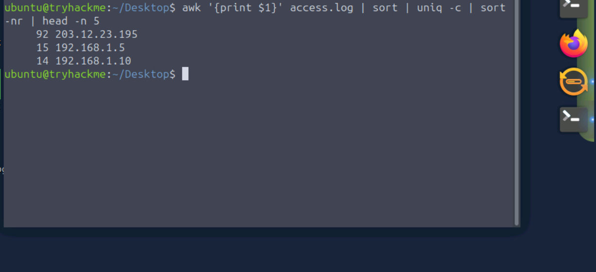
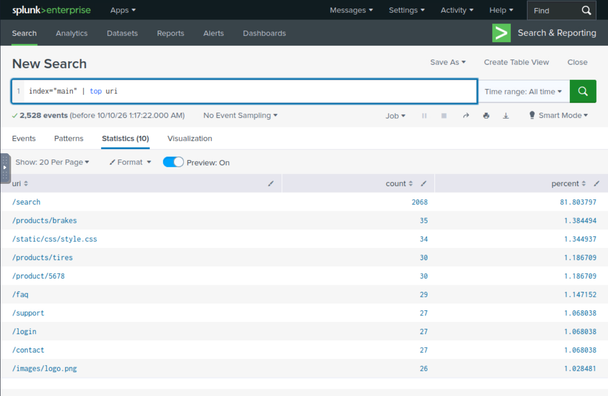
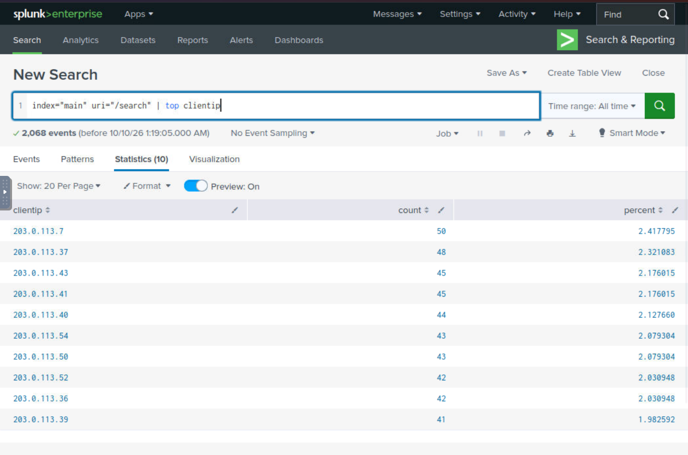
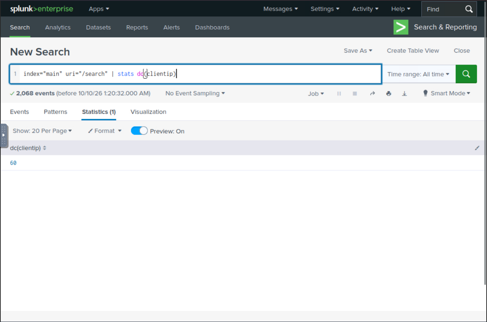
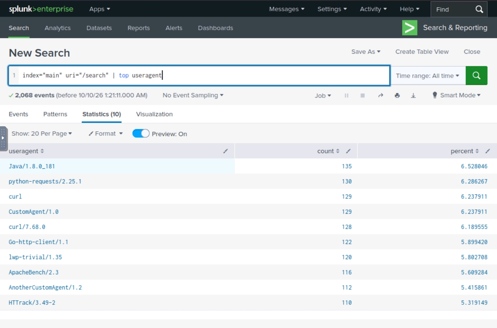
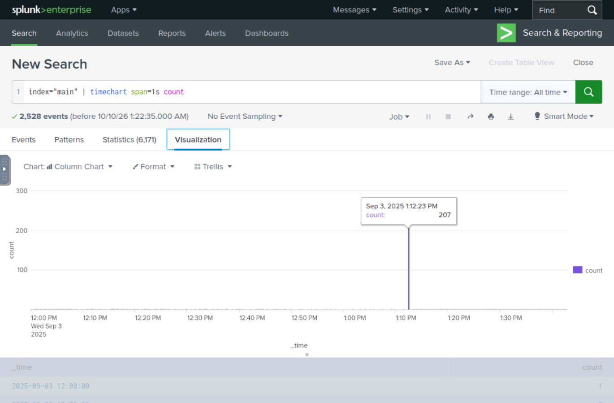
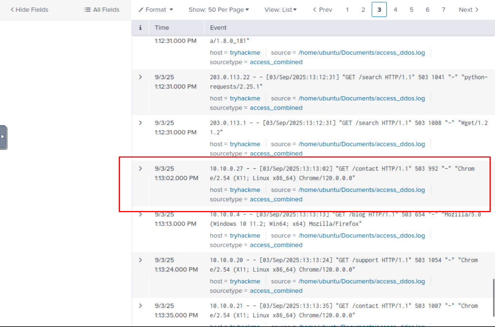

# 🤖 Writeup: Detecting Web DDoS (TryHackMe) 🤖


A diferencia de los ataques colosales tradicionales de red, los ataques de capa(layer) 7 buscan agotar los recursos del servidor apuntando a endpoints que requieren un alto procesamiento en la base de datos
como por ejemplo (/login search)

Este writeup tiene como objetivo documentar el proceso de triaje, pasando desde el análisis manual de logs crudos en la terminal de Linux hasta la investigación avanzada utilizando Splunk (SIEM), culminando con estrategias de mitigación. 

## Fase 1: Análisis Manual de Logs (CLI)

Durante las primeras etapas del incidente, el servidor comenzó a arrojar errores HTTP 503 Service Unavailable, indicando una denegación de servicio. Para identificar rápidamente al atacante en un entorno sin SIEM, procesamos el archivo access.log nativo del servidor web utilizando herramientas de la terminal de Linux.
Identificación de la IP del Atacante

```
awk '{print $1}' access.log | sort | uniq -c | sort -nr | head -n 5}
```


## Comando usado y su desglose
```
awk '{print $1}': Extrae la primera columna del log (Dirección IP).

sort: Ordena las IPs numéricamente (necesario para el siguiente paso).

uniq -c: Comprime los duplicados y cuenta cuántas veces aparece cada IP.

sort -nr: Ordena el resultado de mayor a menor (-r reverse, -n numeric).

head -n 5: Muestra solo el Top 5 de agresores.
```
## Resultado 

```
Se identificó la IP principal del atacante: 203.12.23.195.
```

Para encontrar la dirección IP que estaba generando la anomalía de tráfico, ejecutamos un pipeline de filtrado:

## Identificación del Vector de Ataque

Para confirmar qué recurso de la aplicación estaba siendo bombardeado por esta IP, filtramos sus peticiones específicas:

```
grep "203.12.23.195" access.log | awk '{print $7}' | sort | uniq -c | sort -nr
```

## Resultado 

El atacante estaba realizando un HTTP Flood dirigido repetidamente al endpoint de autenticación, forzando a la base de datos a colapsar.

## Fase 2: Investigación Avanzada con SIEM (Splunk)

Para comprender la magnitud completa del ataque distribuido (botnet), indexamos los logs en Splunk. Utilizando Splunk Processing Language (SPL), respondimos a las interrogantes clave del incidente.

1. Identificar el recurso (URI) más atacado: 



Identificamos rápidamente la página objetivo basándonos en el volumen desproporcionado de peticiones. "2068" 

2. Identificar al principal agresor hacia ese recurso:



3. Determinar el tamaño de la Botnet (IPs únicas):
Para confirmar que se trataba de un ataque distribuido, contamos cuántas IPs distintas participaron en el bombardeo al endpoint.



(El comando dc o Distinct Count arrojó el número exacto de nodos zombis).

4. Identificar la huella de la herramienta automatizada:

 

Los bots suelen compartir un User-Agent específico, lo que permite crear reglas de bloqueo rápido.

5. Medir la intensidad del ataque (Peticiones por segundo):

 

Visualizamos el pico exacto de fuerza bruta graficando los eventos segundo a segundo. "207"

6. Identificar a la primera víctima legítima afectada:
Buscamos al primer usuario real que recibió el error 503 de caída del servidor.
```
Splunk SPL

index="main" status=503 | sort _time
```
 

Ordenando cronológicamente, filtramos las IPs del atacante para encontrar la primera IP legítima afectada.

### Fase 3: Estrategias de Mitigación y Defensa

Para prevenir futuros ataques de Capa 7 y asegurar la disponibilidad del servicio (Tríada CIA), se recomienda implementar la siguiente arquitectura de defensa:
```
Desafíos Cognitivos y de Ejecución (CAPTCHA/JavaScript): Implementar validaciones invisibles en JS o desafíos CAPTCHA en formularios críticos (/login, /register) para bloquear scripts automatizados que no pueden procesar estos retos.

Content Delivery Network (CDN): Desplegar una CDN (ej. Cloudflare, Akamai) para almacenar en caché el contenido estático en servidores periféricos (edge servers). Esto absorbe los picos volumétricos y utiliza Load-Balancing para distribuir el tráfico legítimo entre múltiples servidores de origen.

Web Application Firewall (WAF): Integrar un WAF para inspeccionar el tráfico entrante de Capa 7. Se deben configurar reglas estrictas de Rate-Limiting (límite de peticiones por minuto por IP) y filtrar peticiones basándose en firmas de User-Agents maliciosos o peticiones malformadas.

Validación de Entradas (Secure Coding): Asegurar que el código fuente de la aplicación sanitice y valide estrictamente los datos ingresados por el usuario, evitando el abuso lógico en consultas a bases de datos (Logic Abuse y Oversized Queries).
```

### Fase 4: Habilidades demostradas 
```
La resolución de este incidente subraya que la eficacia de un analista SOC no reside únicamente en saber usar herramientas, sino en comprender la anatomía y el objetivo del ataque. 
Enfrentar un DDoS de Capa 7 requiere ir más allá del monitoreo de red tradicional; exige entender cómo interactúa el tráfico malicioso con la lógica de la aplicación y los recursos del servidor. 
La transición de analizar registros crudos en texto plano a correlacionar eventos estructurados en un SIEM demuestra el flujo de trabajo real necesario para aislar amenazas complejas y escalar la defensa frente a botnets modernas.
```
Este análisis fue realizado como parte del entrenamiento continuo en operaciones defensivas y análisis de tráfico.

