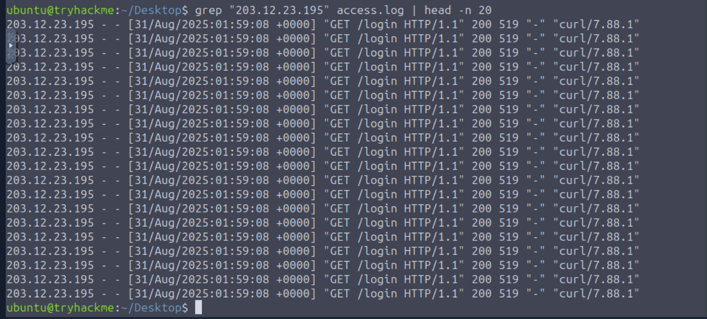

# Writeup: Detección e Investigación de un HTTP Flood de Capa 7


## Resumen

Este writeup documenta la investigación de un incidente de disponibilidad en una aplicación web, comenzando con el análisis manual de `access.log` y continuando con la correlación de eventos mediante Splunk.

La investigación permitió identificar un volumen anómalo de solicitudes HTTP concentradas sobre un recurso de autenticación, determinar las principales fuentes de tráfico y analizar la distribución temporal de las peticiones.

El objetivo no es atribuir automáticamente la actividad a una botnet ni asumir una causa concreta de degradación del servicio, sino utilizar la evidencia disponible para determinar qué comportamiento se observó, cuál es su impacto y qué medidas defensivas podrían reducir el riesgo.

---

## Contexto del Incidente

Los ataques de aplicación de Capa 7 pueden generar una carga significativa sobre servidores web y componentes posteriores, especialmente cuando las solicitudes alcanzan endpoints que requieren procesamiento adicional, como autenticación, búsquedas o consultas dinámicas.

En este escenario se observaron respuestas `HTTP 503 Service Unavailable`, por lo que la investigación se centró inicialmente en determinar si existía una concentración anómala de solicitudes y qué recurso estaba siendo afectado.

### Hipótesis inicial

> **Hipótesis:** un volumen anómalo y automatizado de solicitudes HTTP está contribuyendo a la degradación de disponibilidad del servicio.

La hipótesis se valida progresivamente mediante volumen, distribución temporal, URI objetivo, número de fuentes y comportamiento observado en los logs.

---

# Fase 1: Análisis Manual de Logs (CLI)

## Identificación de las principales fuentes de tráfico

Para obtener una primera aproximación a las fuentes con mayor volumen de solicitudes, se procesó el archivo `access.log` mediante herramientas estándar de Linux.

```bash
awk '{print $1}' access.log | sort | uniq -c | sort -nr | head -n 5
```


### Desglose

- `awk '{print $1}'`: extrae el primer campo del registro, correspondiente a la dirección IP en el formato de log utilizado por el laboratorio.
- `sort`: agrupa las direcciones iguales para que `uniq` pueda contarlas.
- `uniq -c`: cuenta las apariciones consecutivas de cada IP.
- `sort -nr`: ordena los resultados por cantidad, de mayor a menor.
- `head -n 5`: muestra las cinco fuentes con mayor número de solicitudes.

### Resultado

La IP con mayor volumen observado fue:

```text
203.12.23.195
```

> **Consideración SOC:** un alto número de solicitudes desde una única IP no demuestra por sí mismo que dicha dirección sea maliciosa. Debe analizarse junto con el recurso solicitado, la frecuencia, los códigos HTTP y el comportamiento temporal.

---

# Fase 2: Identificación del Recurso Afectado

Para determinar qué recurso estaba recibiendo las solicitudes de la IP identificada, se filtraron sus eventos y se agruparon las URI solicitadas.

```bash
grep "203.12.23.195" access.log | awk '{print $7}' | sort | uniq -c | sort -nr
```



### Resultado

El análisis mostró una concentración significativa de solicitudes sobre el endpoint de autenticación.

Este comportamiento es compatible con un **HTTP Flood dirigido a un recurso específico**, especialmente si el endpoint requiere procesamiento dinámico.

> **Limitación:** a partir del log de acceso se puede establecer el patrón de solicitudes observado, pero no afirmar por sí solo que la base de datos “colapsó”. Para demostrar la causa exacta de la indisponibilidad sería necesario correlacionar estos eventos con métricas del servidor, aplicación, base de datos y recursos como CPU, memoria o conexiones.

---

# Fase 3: Investigación con Splunk (SIEM)

Para ampliar el análisis se utilizaron los logs indexados en Splunk. El objetivo fue responder preguntas operativas típicas de un SOC:

1. ¿Qué recurso está siendo atacado?
2. ¿Qué fuentes generan mayor volumen?
3. ¿La actividad proviene de una única dirección o de múltiples fuentes?
4. ¿Existe un patrón temporal compatible con automatización?
5. ¿Qué impacto tuvo la actividad sobre usuarios legítimos?

## 1. Identificar el recurso más atacado


La consulta permitió identificar el recurso que concentraba el mayor volumen de solicitudes durante el incidente.

El resultado observado fue de aproximadamente **2068 solicitudes** para el recurso analizado.

---

## 2. Identificar las principales fuentes de tráfico


La investigación permitió determinar qué direcciones IP contribuyeron en mayor medida al volumen de solicitudes.

Este dato resulta útil para diferenciar entre un patrón altamente concentrado y uno distribuido entre múltiples fuentes.

---

## 3. Determinar la distribución de IPs

Para evaluar si el tráfico estaba distribuido entre múltiples fuentes se contabilizaron las direcciones IP únicas asociadas al recurso objetivo.


La presencia de múltiples fuentes es compatible con actividad distribuida, pero **no es suficiente por sí sola para atribuir el incidente a una botnet**. Una conclusión de ese tipo requeriría evidencia adicional sobre el control común o la naturaleza automatizada de los nodos.

Desde una perspectiva SOC, es más preciso hablar de **tráfico distribuido desde múltiples IPs** mientras no exista evidencia suficiente para una atribución más específica.

---

## 4. Identificar patrones de automatización


El análisis del `User-Agent` permitió identificar una característica común entre parte de las solicitudes observadas.

Un `User-Agent` repetido puede ser útil como indicador de automatización y como criterio adicional para una detección o regla defensiva. Sin embargo, no debería utilizarse como único mecanismo de bloqueo, ya que puede ser falsificado con facilidad.

---

## 5. Medir la intensidad del tráfico


La visualización temporal permitió observar el volumen de solicitudes por segundo y localizar el periodo de mayor intensidad.

El pico observado fue de aproximadamente **207 solicitudes por segundo**.

Este tipo de métrica es especialmente útil para un SOC porque permite establecer una línea temporal del incidente y relacionar el aumento de tráfico con los primeros errores `503` observados.

---

## 6. Identificar el primer impacto visible sobre usuarios

Se utilizó la siguiente consulta para ordenar temporalmente las respuestas `503`:

```spl
index="main" status=503 | sort _time
```


El objetivo fue identificar cuándo comenzaron a observarse respuestas de indisponibilidad y posteriormente distinguir el tráfico asociado al ataque del tráfico legítimo.

> **Consideración:** la identificación de una “víctima legítima” debe basarse en el contexto de la IP, comportamiento del usuario y patrón de solicitudes. Una dirección que reciba un `503` no puede clasificarse automáticamente como víctima legítima sin ese contexto.

---

# Correlación del Incidente

La investigación permite construir la siguiente secuencia:

```text
Aumento anómalo de solicitudes
            ↓
Concentración sobre endpoint de autenticación
            ↓
Múltiples fuentes de tráfico
            ↓
Patrón temporal de alta frecuencia
            ↓
Aparición de respuestas HTTP 503
            ↓
Degradación de disponibilidad observada
```

La evidencia es consistente con un **HTTP Flood de Capa 7**, con actividad distribuida entre múltiples fuentes.

La atribución específica de los nodos a una botnet no se considera demostrada únicamente con los logs analizados.

---

# Evaluación SOC

| Campo | Evaluación |
|---|---|
| **Tipo de actividad** | HTTP Flood / DDoS de Capa 7 |
| **Recurso objetivo** | Endpoint de autenticación |
| **Fuentes** | Múltiples direcciones IP |
| **Pico observado** | ~207 solicitudes/segundo |
| **Impacto observado** | Respuestas `HTTP 503` |
| **Automatización** | Compatible con patrones observados en logs |
| **Atribución a botnet** | No confirmada con la evidencia disponible |
| **Severidad** | Alta, debido al impacto sobre disponibilidad |
| **Confianza** | Alta para el patrón de HTTP Flood; menor para atribución de infraestructura |

---

# Mitigación y Respuesta

Las medidas defensivas deben aplicarse según la arquitectura de la aplicación y el patrón observado.

### 1. Rate Limiting

Aplicar límites de solicitudes por IP, sesión, identidad o combinación de atributos. Para endpoints sensibles como `/login`, los límites deben considerar también controles específicos contra automatización y abuso de credenciales.

### 2. WAF

Un Web Application Firewall puede ayudar a inspeccionar y filtrar solicitudes antes de que alcancen la aplicación. Las reglas deben combinar múltiples señales y evitar depender únicamente del `User-Agent`.

### 3. CDN / Protección DDoS

Una CDN o servicio especializado de mitigación puede absorber parte del tráfico y aplicar controles distribuidos antes de que las solicitudes alcancen la infraestructura de origen.

### 4. Protección de endpoints críticos

Los endpoints dinámicos que generan consultas costosas deben diseñarse para minimizar el impacto de solicitudes repetitivas. Esto puede incluir caching cuando sea apropiado, límites de concurrencia y controles de abuso.

### 5. Monitoreo y alertas

El SOC debería monitorizar al menos:

- solicitudes por segundo;
- tasa de respuestas `4xx/5xx`;
- distribución por IP;
- URI objetivo;
- `User-Agent`;
- latencia de aplicación;
- conexiones concurrentes;
- consumo de CPU y memoria;
- métricas de base de datos cuando el endpoint dependa de ella.

### 6. Preservación de evidencia

Antes de aplicar bloqueos masivos conviene conservar los logs relevantes, timestamps, IPs, URI, User-Agent y demás indicadores necesarios para reconstruir el incidente posteriormente.

---

# Detecciones que podrían implementarse

El análisis también permite derivar posibles casos de uso para un SIEM:

### Detección 1 — Alto volumen por IP

Alertar cuando una dirección supere un umbral de solicitudes dentro de una ventana temporal determinada.

### Detección 2 — Concentración sobre un endpoint

Detectar cuando un recurso específico recibe un volumen anormal de solicitudes respecto a su línea base.

### Detección 3 — Distribución anómala

Detectar incrementos repentinos de solicitudes procedentes de múltiples IPs hacia el mismo recurso.

### Detección 4 — Correlación con errores HTTP

Relacionar aumentos de tráfico con incrementos de `HTTP 5xx`, especialmente `503`, para priorizar incidentes con impacto real sobre disponibilidad.

> **Importante:** los umbrales deben calibrarse utilizando el tráfico normal de la aplicación. Un número fijo de solicitudes no es universalmente malicioso.

---

# Conclusiones y Aprendizajes

Este laboratorio demuestra un flujo de investigación aplicable a un entorno SOC: comenzar con una señal básica de disponibilidad, reducir el espacio de búsqueda mediante análisis de logs y posteriormente utilizar un SIEM para correlacionar volumen, fuentes, recursos, temporalidad e impacto.

La principal conclusión no es simplemente que existieron muchas solicitudes, sino que la combinación de **volumen anómalo + concentración sobre un endpoint + múltiples fuentes + alta frecuencia + respuestas `503`** proporciona evidencia consistente con un HTTP Flood de Capa 7.

También resulta importante diferenciar entre lo observado y lo inferido. La presencia de múltiples IPs puede indicar tráfico distribuido, pero no permite atribuir automáticamente la actividad a una botnet. Del mismo modo, los `503` demuestran errores de disponibilidad observados, pero no determinan por sí solos qué componente de la infraestructura provocó la degradación.

Desde la perspectiva de un analista SOC, este tipo de investigación refuerza la importancia de:

- trabajar con evidencia antes de emitir conclusiones;
- utilizar ventanas temporales y líneas base;
- correlacionar logs de aplicación con métricas de infraestructura;
- distinguir indicadores de compromiso de simples anomalías;
- transformar una investigación en posibles reglas de detección;
- documentar las limitaciones de la evidencia disponible.

Este laboratorio forma parte de mi proceso de formación práctica en análisis defensivo, SIEM e investigación de incidentes.
