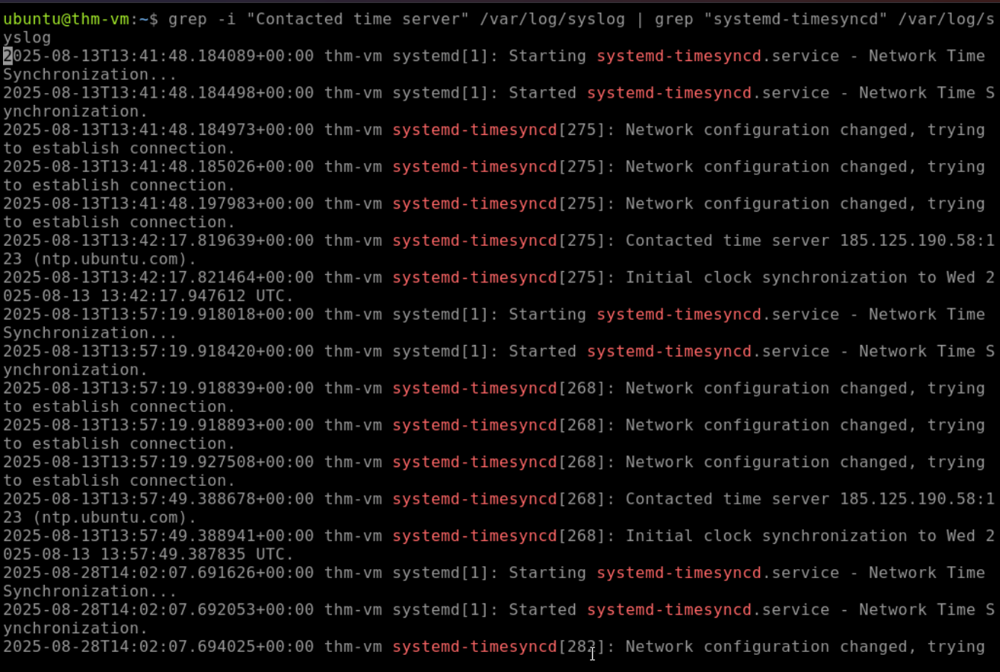
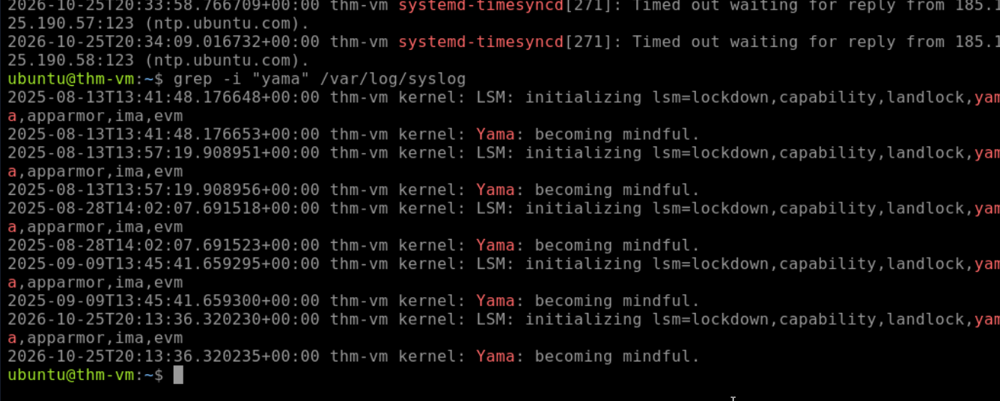
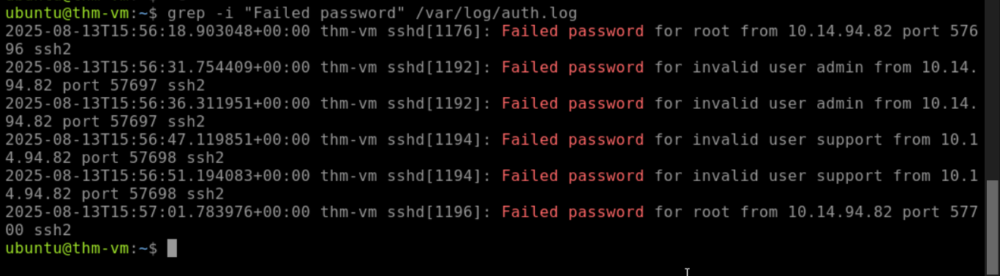
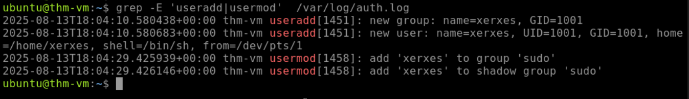
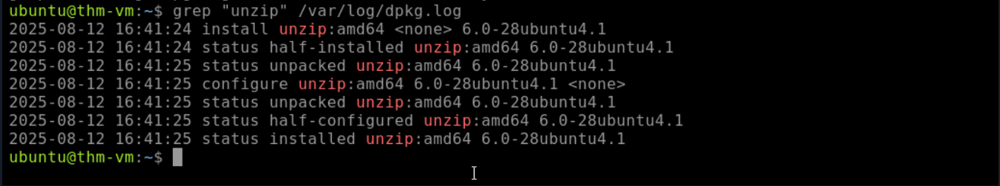
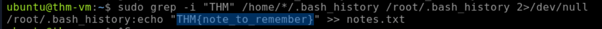
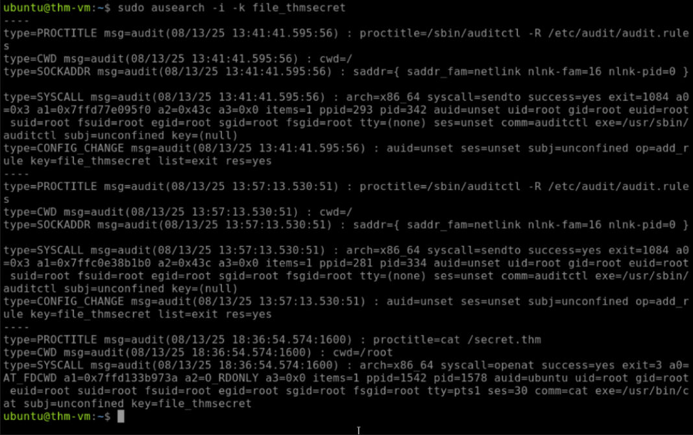
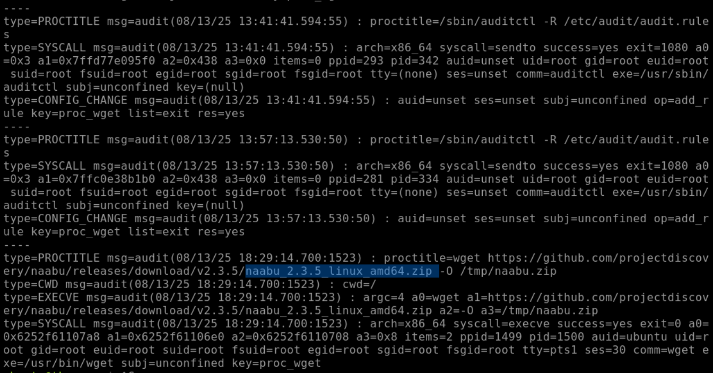
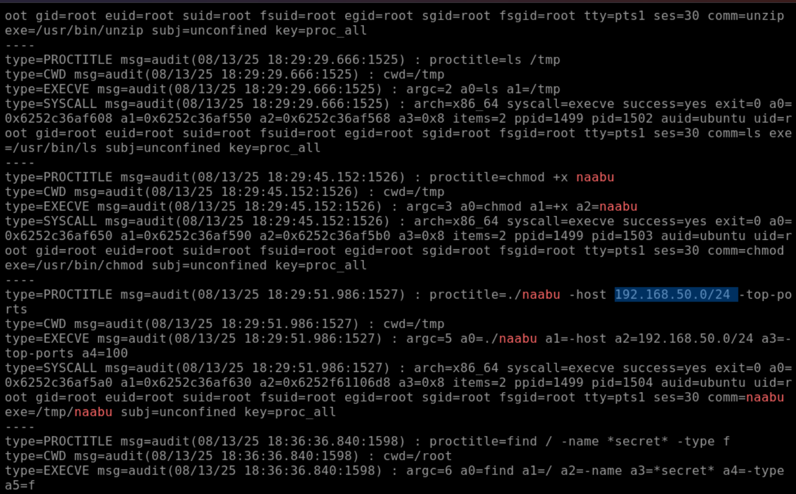

# Writeup: Linux Logging & Runtime Monitoring para SOC


## Introducción

En el ecosistema corporativo moderno, Linux forma parte de una gran variedad de infraestructuras críticas, desde servidores web y bases de datos hasta cargas de trabajo en la nube. Estos sistemas también pueden ser objetivo de actores de amenazas. En este laboratorio, asumo el rol de analista SOC para realizar un triage e investigación de un servidor Ubuntu comprometido, correlacionando evidencia procedente de logs tradicionales con telemetría de `auditd` sobre actividad de procesos y acceso a recursos.

## Resumen

Se investigó un servidor Ubuntu Linux comprometido tras alertas de actividad anómala. El análisis identificó un patrón de intentos fallidos de autenticación SSH compatible con **Password Guessing**, seguido de actividad posterior sobre el sistema. Durante la investigación se observó la creación de una cuenta local con privilegios administrativos, la ejecución de un comando destinado a detener el EDR local y la descarga de la herramienta de escaneo de red **Naabu** mediante `wget`.

La actividad culminó con un escaneo del segmento interno `192.168.50.0/24` y una búsqueda recursiva de archivos cuyo nombre contenía `secret`. La evidencia permite reconstruir estas acciones en el laboratorio, pero no demuestra por sí sola que dichos archivos hayan sido exfiltrados o modificados.

## La importancia del monitoreo en Linux 🐧

Para un Blue Team, la visibilidad es fundamental para reducir el tiempo entre la ocurrencia de una actividad sospechosa y su detección. La recolección y correlación de logs en Linux permite:

- **Reconstruir líneas de tiempo:** relacionar autenticaciones, creación de cuentas, ejecución de comandos y actividad posterior.
- **Identificar TTPs:** mapear comportamientos observados al framework MITRE ATT&CK, cuando la evidencia disponible respalda la técnica.
- **Investigar cambios y actividad sensible:** detectar creación de usuarios, ejecución de herramientas y acceso a rutas que requieran especial atención.
- **Correlacionar fuentes:** combinar logs de autenticación con telemetría de auditoría para obtener mayor contexto que el disponible en una única fuente.

## Desafíos operativos para el SOC

Monitorear sistemas Linux presenta varios desafíos que un analista debe considerar:

- **Falta de estandarización:** el formato y las fuentes de logs pueden variar entre distribuciones, servicios y configuraciones.
- **Ruido excesivo:** archivos como `/var/log/syslog` pueden contener una gran cantidad de eventos legítimos generados por servicios, procesos y tareas programadas.
- **Visibilidad limitada por defecto:** la visibilidad sobre creación de procesos, conexiones de red o acceso a archivos depende de los servicios y mecanismos de auditoría configurados. El historial de shell, por ejemplo, tampoco constituye un registro completo de la actividad ejecutada.
- **Necesidad de telemetría adicional:** herramientas como `auditd` pueden complementar los logs nativos proporcionando eventos de auditoría y argumentos de ejecución para las actividades que hayan sido configuradas para ser auditadas.

## Matriz MITRE ATT&CK

| Táctica | ID Técnica | Nombre de la Técnica | Evidencia en el Incidente |
| :--- | :--- | :--- | :--- |
| **Credential Access** | T1110.001 | Brute Force: Password Guessing | Logs SSH con múltiples eventos `Failed password`. |
| **Persistence** | T1136.001 | Create Account: Local Account | Uso de `useradd` y `usermod` para crear y configurar la cuenta `backdoor`. |
| **Defense Impairment** | T1685 | Disable or Modify Tools | Ejecución mediante `sudo` del comando destinado a detener el EDR local. |
| **Command and Control** | T1105 | Ingress Tool Transfer | Uso de `wget` para descargar el binario de Naabu. |
| **Discovery** | T1083 | File and Directory Discovery | Uso de `find` para realizar una búsqueda recursiva de archivos con `secret` en el nombre. |

> **Nota:** La matriz utiliza la nomenclatura vigente de MITRE ATT&CK para **T1685 — Disable or Modify Tools**.

## Indicadores y artefactos de compromiso

| Tipo | Valor / Artefacto | Descripción |
| :--- | :--- | :--- |
| **Cuenta** | `backdoor` (UID=1002) | Cuenta local agregada al grupo `sudo`. |
| **Comando** | `systemctl stop edr` | Comando observado para detener el agente de seguridad local. |
| **Herramienta** | `naabu_2.3.5_linux_amd64.zip` | Herramienta de escaneo descargada mediante `wget` y almacenada en `/tmp`. |
| **Segmento objetivo** | `192.168.50.0/24` | Segmento interno contra el que se observó actividad de escaneo. |

## Metodología de investigación y ejecución de comandos

A continuación, se detalla el flujo de investigación y los comandos utilizados durante el laboratorio.

### 1. Triage inicial y correlación temporal (`/var/log/syslog`)

Antes de analizar anomalías, es útil verificar la información temporal del sistema para interpretar correctamente los timestamps de los logs. También se revisaron mensajes relacionados con componentes de seguridad del kernel.

```bash
# Identificar el servidor de tiempo contactado por el sistema
grep -i "Contacted time server" /var/log/syslog

# Revisar mensajes relacionados con Yama
grep -i "yama" /var/log/syslog
```




### 2. Auditoría de autenticación y persistencia (`/var/log/auth.log`)

El archivo de autenticación constituye una fuente importante para investigar accesos SSH, intentos fallidos y determinadas operaciones de administración de cuentas. En este caso se buscaron patrones compatibles con password guessing y rastros de creación o modificación de cuentas.

```bash
# Agrupar y contar intentos fallidos de inicio de sesión SSH
grep "Failed password" /var/log/auth.log | awk '{print $11, $9}' | sort | uniq -c

# Detectar eventos relacionados con creación o modificación de cuentas
grep -E 'useradd|usermod' /var/log/auth.log
```




### 3. Rastreo de artefactos e historial de usuarios

Los atacantes pueden utilizar herramientas adicionales para reconocimiento, transferencia de archivos o manipulación del sistema. Por ello, se revisaron los registros del gestor de paquetes y los historiales de shell disponibles en el laboratorio.

```bash
# Buscar referencias a la instalación de unzip en los logs del gestor de paquetes
grep "unzip" /var/log/dpkg.log

# Revisar los historiales de Bash disponibles para los usuarios
sudo cat /home/*/.bash_history /root/.bash_history 2>/dev/null

# Buscar la flag del desafío en los historiales disponibles
sudo grep -i "THM" /home/*/.bash_history /root/.bash_history 2>/dev/null
```




> **Limitación:** el historial de Bash es una fuente complementaria y no debe interpretarse como un registro completo de la actividad del usuario. Puede no contener comandos ejecutados desde otras shells, comandos borrados o actividad que no haya sido registrada por el mecanismo de historial.

### 4. Runtime Monitoring y reconstrucción del ataque (`auditd`)

Para complementar los logs nativos, se utilizaron `ausearch` y los registros de `auditd` ubicados en `/var/log/audit/audit.log`. Las reglas de auditoría configuradas en el laboratorio permitieron investigar eventos relacionados con acceso a archivos y ejecución de `wget`.

```bash
# Investigar eventos asociados a la regla de auditoría para archivos sensibles
sudo ausearch -i -k file_thmsecret

# Investigar eventos asociados a la ejecución de wget
sudo ausearch -i -k proc_wget
```



## Hallazgo crítico: reconstrucción de la actividad

La correlación de los eventos de `auditd` permitió reconstruir una cadena de actividad posterior al acceso inicial:

1. El atacante utilizó `wget` para descargar la herramienta **Naabu**.
2. El archivo fue almacenado en `/tmp` y posteriormente se observó la modificación de sus permisos mediante `chmod +x`.
3. Se ejecutó Naabu contra el segmento interno `192.168.50.0/24`, realizando actividad de descubrimiento de servicios.
4. Finalmente, se ejecutó `find / -name *secret* -type f`, realizando una búsqueda recursiva de archivos cuyo nombre coincidiera con `secret`.

La evidencia permite afirmar que estas acciones fueron ejecutadas en el entorno del laboratorio. **No permite afirmar, sin evidencia adicional, que los archivos encontrados hayan sido abiertos, modificados o exfiltrados.**




## Recomendaciones y plan de remediación

1. **Hardening de SSH:** deshabilitar la autenticación por contraseña cuando el entorno lo permita (`PasswordAuthentication no` en `/etc/ssh/sshd_config`) y utilizar autenticación mediante claves públicas con algoritmos aprobados por la organización.
2. **Mitigación de Password Guessing:** desplegar controles como **Fail2Ban** o **CrowdSec**, además de MFA cuando sea técnicamente viable, y establecer políticas adecuadas de autenticación y bloqueo.
3. **Restricción de ejecución en directorios temporales:** evaluar `noexec` para `/tmp` y `/var/tmp` como una capa adicional de defensa. Esta medida puede reducir la ejecución directa de binarios desde dichos directorios, pero no debe considerarse una solución completa, ya que existen mecanismos alternativos de ejecución.
4. **Centralización de logs (SIEM):** enviar `syslog`, `auth.log` y `audit.log` a una infraestructura centralizada. Esto permite conservar evidencia fuera del host comprometido y facilita la correlación entre múltiples fuentes y sistemas.
5. **Monitoreo de cuentas privilegiadas:** generar alertas ante creación de usuarios locales, incorporación de cuentas a grupos administrativos y cambios inesperados en servicios de seguridad.

## Conclusión

Este laboratorio demuestra una diferencia fundamental entre **tener logs** y disponer de **telemetría suficiente para investigar**. Los logs tradicionales de Linux permitieron identificar actividad de autenticación y administración de cuentas, mientras que `auditd` aportó mayor contexto sobre determinadas ejecuciones y accesos auditados.

La correlación de ambas fuentes permitió pasar de observar eventos aislados a reconstruir una secuencia de actividad: acceso SSH, creación de una cuenta privilegiada, intento de deshabilitar el EDR, transferencia de una herramienta, reconocimiento de red y búsqueda de archivos sensibles.

Al mismo tiempo, la investigación muestra la importancia de respetar los límites de la evidencia: observar una búsqueda de archivos no demuestra exfiltración, y observar la descarga de una herramienta no implica por sí solo que haya sido utilizada con fines maliciosos. El valor del análisis SOC está en **correlacionar evidencia, formular hipótesis y distinguir claramente entre lo observado y lo que todavía debe demostrarse**.
