# 🛡️ Writeup: Investigación de un Endpoint Windows mediante Event Logs, Sysmon y PowerShell


Writeups/Windows Logging for SOC/Investigación forense de endpoint Windows.png
## Resumen Ejecutivo

Este reporte documenta la investigación de un endpoint Windows comprometido mediante el análisis correlacionado de registros de seguridad nativos (`Security.evtx`), telemetría de Sysmon y artefactos locales de PowerShell.

La investigación permitió reconstruir una secuencia de actividad que comienza con múltiples intentos fallidos de autenticación RDP y un inicio de sesión exitoso, seguido por modificaciones en las cuentas y grupos locales, descarga y ejecución de un artefacto, comunicaciones de red asociadas al proceso y establecimiento de persistencia.

Posteriormente, el análisis del historial de PowerShell permitió identificar comandos relacionados con descubrimiento del sistema y revisión de las capacidades de Microsoft Defender.

La investigación se basa en la correlación temporal y contextual de distintas fuentes de evidencia. Cuando la evidencia disponible no permite confirmar una determinada acción, se diferencia explícitamente entre hechos observados, inferencias e hipótesis.

---

## Metodología de Investigación

La investigación se realizó mediante la correlación de distintas fuentes de telemetría:

- **Windows Security Event Log:** autenticaciones, creación de cuentas y modificaciones de grupos.
- **Sysmon:** creación de procesos, archivos, conexiones de red y consultas DNS.
- **PSReadline:** comandos registrados durante sesiones de PowerShell.
- **Correlación temporal:** relación entre eventos ocurridos durante la misma secuencia de actividad.
- **Correlación contextual:** relación entre usuarios, procesos, archivos, direcciones IP, dominios y sesiones.

El objetivo no fue analizar cada evento de forma aislada, sino determinar si las distintas evidencias podían formar una secuencia coherente de compromiso.

---

# Timeline de la Intrusión

| Etapa | Fuente | Evento | Interpretación |
|---|---|---|---|
| Acceso inicial | Security.evtx | `4625` | Múltiples fallos de autenticación |
| Acceso inicial | Security.evtx | `4624` | Inicio de sesión RDP exitoso |
| Persistencia | Security.evtx | `4720` | Creación de cuenta local |
| Persistencia | Security.evtx | `4732` | Incorporación de cuenta a grupos locales |
| Entrega | Sysmon | `Event ID 15` | Registro del origen del archivo descargado |
| Ejecución | Sysmon | `Event ID 1` | Creación de procesos |
| C2 | Sysmon | `Event ID 22` | Resolución DNS |
| C2 | Sysmon | `Event ID 3` | Conexión de red |
| Persistencia | Sysmon | `Event ID 11` | Creación de archivo en Startup |
| Post-explotación | PSReadline | `ConsoleHost_history.txt` | Comandos ejecutados durante la sesión |

> **Nota:** Los timestamps exactos deben conservarse en la evidencia original. La tabla representa la secuencia lógica de la investigación.

---

# Análisis Táctico de la Cadena de Ataque

## 1. Acceso Inicial — RDP

El análisis del Visor de Eventos reveló múltiples intentos fallidos de autenticación seguidos de un inicio de sesión RDP exitoso en el endpoint `THM-PC`.

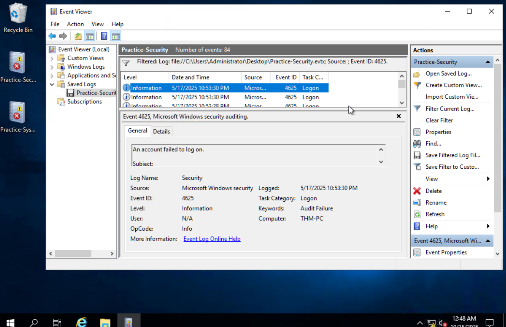

**Eventos involucrados:**

- `4625` — An account failed to log on.
- `4624` — An account was successfully logged on.
- `Logon Type 10` — RemoteInteractive, asociado a sesiones RDP.

**Datos observados:**

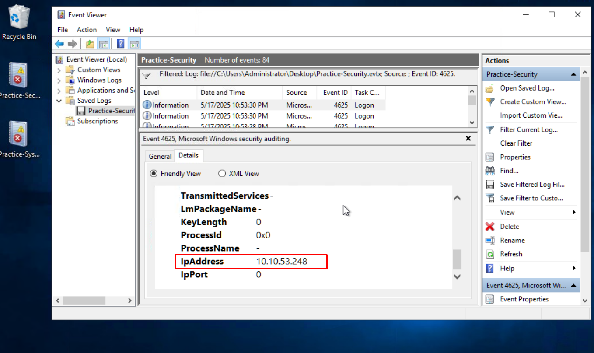

- **IP de origen:** `10.10.53.248`
- **Cuenta:** `Administrator`
- **Logon ID:** `0x183c36d`


La secuencia de múltiples eventos `4625` seguida de un `4624` desde la misma fuente es **consistente con un intento de fuerza bruta exitoso contra RDP**.

El `Logon ID` del evento `4624` resulta especialmente importante para la investigación, ya que funciona como un identificador de correlación que permite relacionar otros eventos generados durante la misma sesión.

### 🔎 Consideración para el SOC

Un evento `4624` aislado no debería considerarse automáticamente malicioso. La investigación debe considerar:

- IP de origen.
- Tipo de logon.
- Usuario utilizado.
- Cantidad y frecuencia de fallos previos.
- Horario de la actividad.
- Actividad posterior asociada al mismo `Logon ID`.

En este caso, la actividad posterior proporciona contexto adicional que incrementa la sospecha sobre la autenticación.

---

# 2. Persistencia y Asignación de Privilegios

Después del inicio de sesión exitoso, se observaron modificaciones en las cuentas y grupos locales del sistema.

**Eventos involucrados:**

- `4720` — Creación de una cuenta de usuario.
- `4732` — Incorporación de un miembro a un grupo local.

**Cuenta creada:**
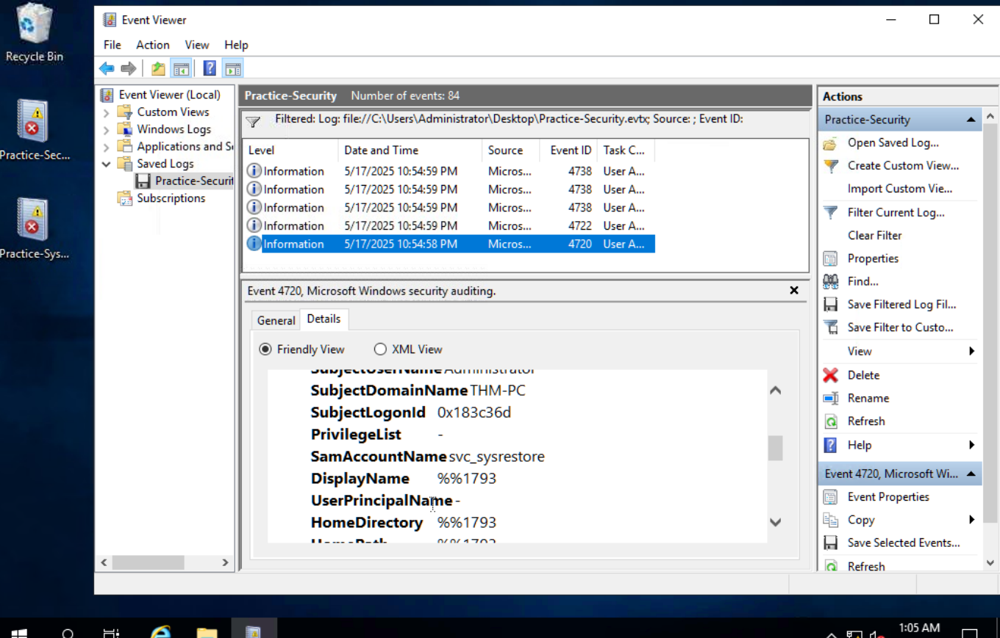

`svc_sysrestore`

**Grupos identificados:**

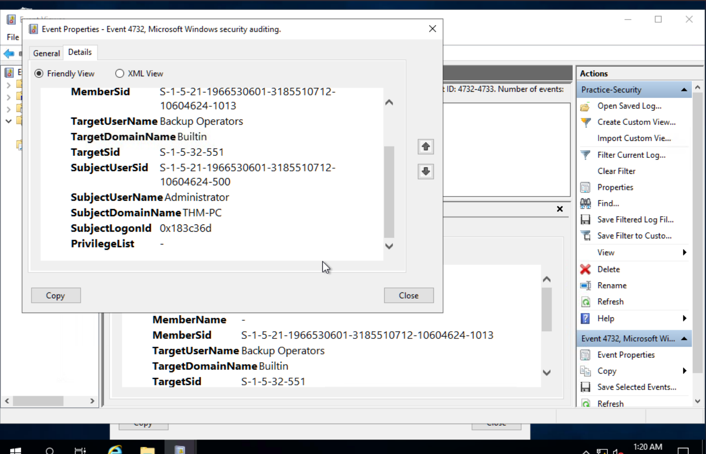
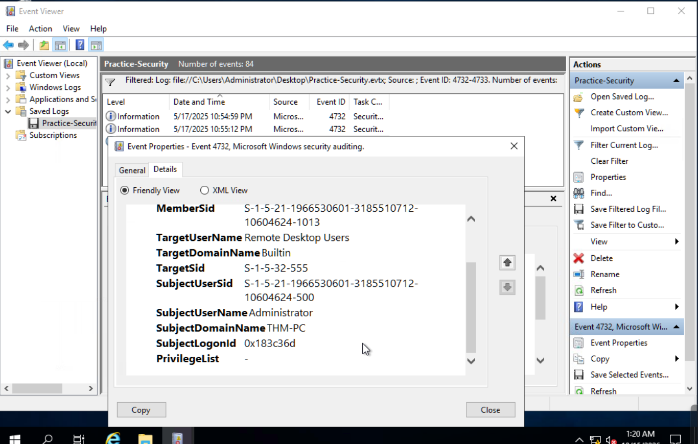

- `Backup Operators`
- `Remote Desktop Users`

El nombre `svc_sysrestore` presenta características compatibles con una cuenta diseñada para aparentar ser un servicio legítimo. Sin embargo, el nombre por sí solo no constituye evidencia suficiente de intención maliciosa; su relevancia aumenta al correlacionarlo con el contexto de la intrusión.

La pertenencia a `Backup Operators` resulta especialmente relevante desde una perspectiva defensiva, debido a los privilegios asociados a operaciones de backup y acceso a determinados recursos protegidos.

Estos privilegios **podrían ser abusados para acceder a información sensible del sistema**, incluyendo material relacionado con las bases de datos `SAM` y `SYSTEM`.

> **Limitación:** La evidencia presentada en este análisis demuestra la creación de la cuenta y su incorporación a grupos, pero no permite confirmar por sí sola que se haya realizado una extracción de credenciales desde `SAM` o `SYSTEM`.

### Consideración para el SOC

La creación de cuentas locales privilegiadas debería correlacionarse con:

- `SubjectUserName`
- `SubjectLogonId`
- `TargetUserName`
- grupos modificados
- procesos ejecutados posteriormente
- origen de la sesión
- horario de la actividad

La correlación de estos campos puede ayudar a determinar si la modificación fue realizada por un administrador legítimo o por una sesión comprometida.

---

# 3. Entrega y Ejecución del Payload

La telemetría de Sysmon permitió identificar actividad asociada con la descarga de un archivo potencialmente malicioso.

### Sysmon Event ID 1 — Process Creation

Se identificó actividad de `chrome.exe` asociada al usuario:

`sarah.miller`

### Sysmon Event ID 15 — FileCreateStreamHash

El evento permitió identificar información asociada al **Mark of the Web (MotW)** del archivo descargado mediante el Alternate Data Stream utilizado por Windows para registrar información sobre el origen del archivo.

**Artefacto identificado:**
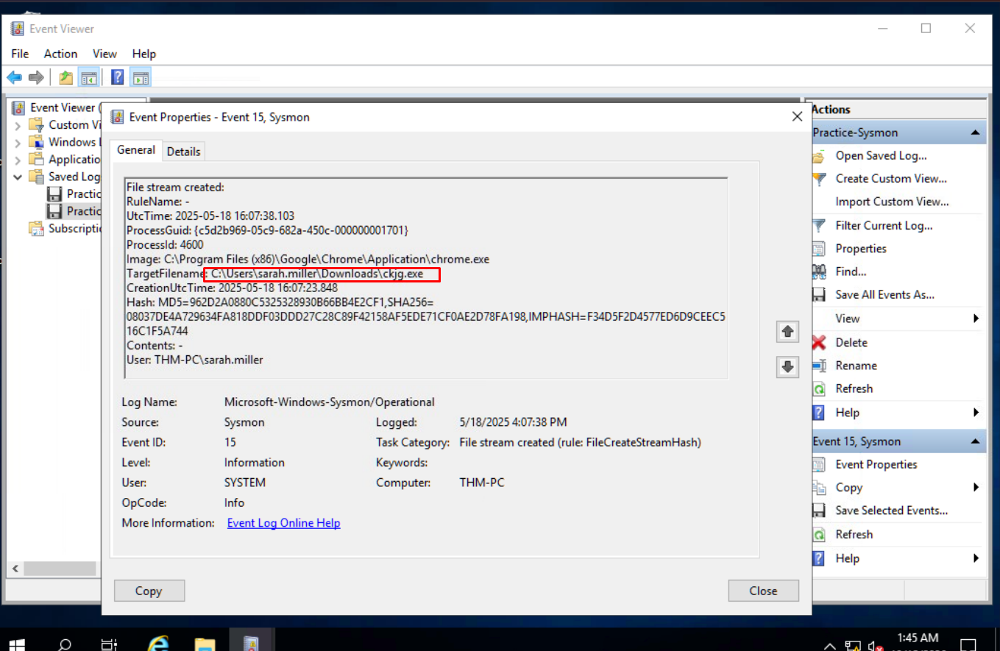

`ckjg.exe`

**URL de origen:**
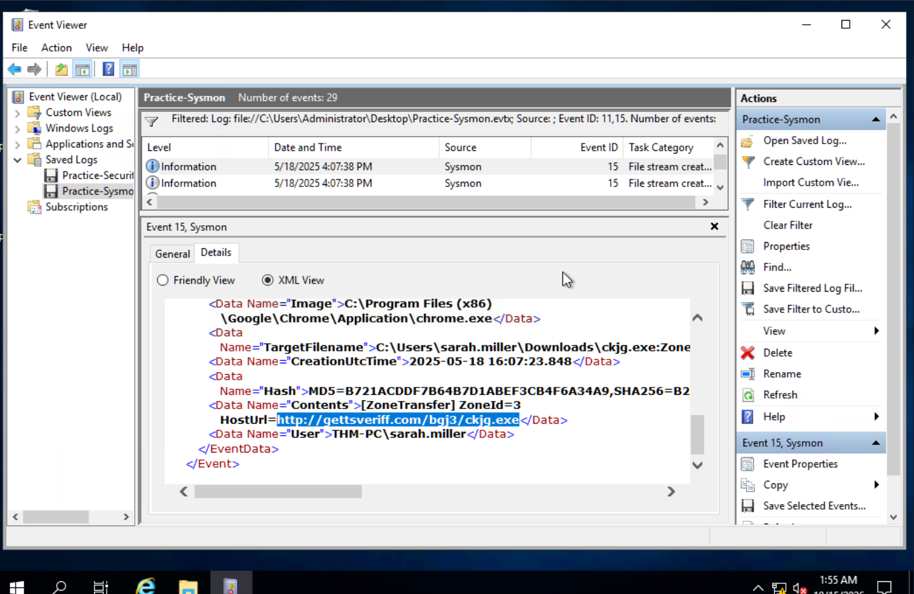

`http://gettsveriff.com/bgj3/ckjg.exe`


La información de origen resulta relevante para el análisis porque permite identificar infraestructura potencialmente relacionada con la entrega del artefacto y generar indicadores para futuras investigaciones.

### 🔎 Distinción entre descarga y ejecución

La descarga de un archivo no implica necesariamente que este haya sido ejecutado.

Por este motivo, la investigación debe buscar evidencia adicional, particularmente:

- Sysmon Event ID `1`
- `Image`
- `ParentImage`
- `CommandLine`
- `User`
- hashes del archivo
- relación temporal con otros eventos

Si existe un evento de creación de proceso correspondiente a `ckjg.exe`, este debe utilizarse como evidencia directa de ejecución.

---

# 4. Command & Control

Después de la actividad asociada al payload, Sysmon permitió identificar comunicaciones de red potencialmente relacionadas con la ejecución del malware.

**Eventos involucrados:**

- **Sysmon Event ID 3:** Network Connection.
- **Sysmon Event ID 22:** DNS Query.

**Infraestructura observada:**
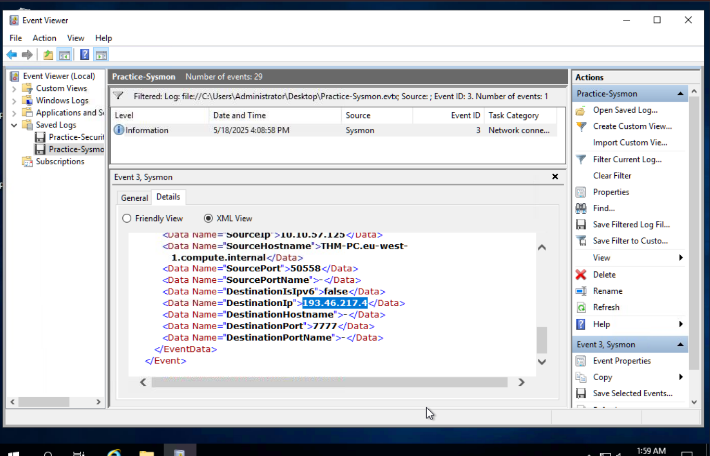


- **IP:** `193.46.217.4`
- **Puerto:** `7777`
- **Dominio:** `hkfasfsafg.click`
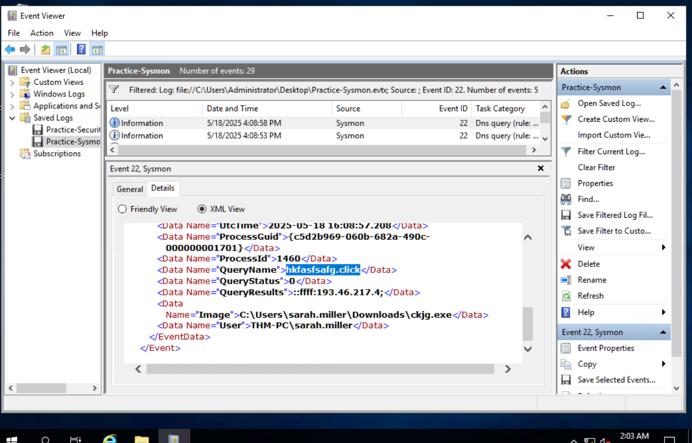

La resolución DNS y posterior conexión de red proporcionan una relación entre la actividad del host y la infraestructura externa identificada.

El dominio presenta características inusuales y fue observado durante la actividad investigada. Sin embargo, la apariencia aleatoria del nombre **no es suficiente por sí sola para afirmar que se trata de un dominio generado mediante DGA**.

Del mismo modo, el uso del puerto `7777` no constituye por sí mismo evidencia de actividad maliciosa. La sospecha aumenta debido a su correlación temporal y contextual con el proceso investigado.

### Consideración para el SOC

La conexión debería analizarse considerando:

- proceso que inició la conexión;
- PID;
- IP destino;
- puerto;
- timestamp;
- consulta DNS previa;
- frecuencia de las conexiones;
- duración;
- volumen de tráfico;
- reputación de la infraestructura.

La combinación de estos elementos proporciona mayor valor analítico que evaluar el puerto o dominio de manera aislada.

---

# 5. Persistencia mediante Startup

Sysmon Event ID `11` permitió identificar la creación del siguiente archivo:

`DeleteApp.url`

Ubicación:

```text
C:\Users\sarah.miller\AppData\Roaming\Microsoft\Windows\Start Menu\Programs\Startup\
```

La ubicación es relevante porque los elementos almacenados en la carpeta `Startup` pueden ejecutarse durante el inicio de sesión del usuario, proporcionando un mecanismo de persistencia.

En este caso, el archivo `DeleteApp.url` debe analizarse para determinar exactamente qué recurso, programa o URL intenta ejecutar.

> **Importante:** La existencia del archivo en Startup demuestra la presencia de un mecanismo potencial de persistencia, pero la naturaleza exacta de la ejecución debe determinarse examinando su contenido y correlacionándolo con la telemetría de procesos.

---

# 6. Post-Explotación y Reconocimiento mediante PowerShell

El análisis del artefacto:

```text
ConsoleHost_history.txt
```
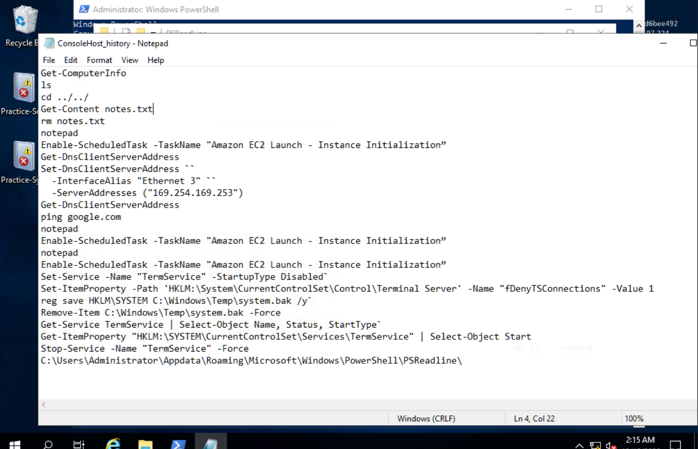

ubicado en:

```text
AppData\Roaming\Microsoft\Windows\PowerShell\PSReadline\
```

permitió recuperar comandos registrados durante la sesión de PowerShell.

### Actividad de descubrimiento


```powershell
Get-LocalUser > users.txt
Get-SmbShare > shares.txt
```
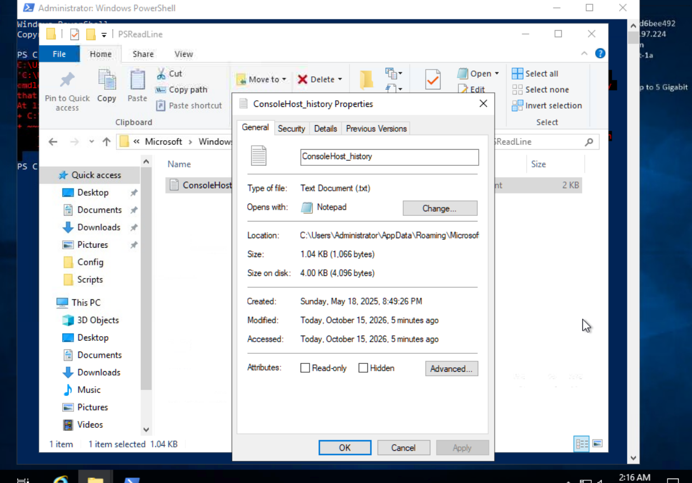

Estos comandos permiten obtener información sobre:

- usuarios locales;
- recursos compartidos SMB.

### Revisión de mecanismos de defensa

```powershell
Get-MpPreference > defender.txt
```

Este comando permite consultar configuraciones y preferencias relacionadas con Microsoft Defender.

También se observó:

```powershell
Clear-RecycleBin
```

que elimina elementos de la papelera de reciclaje.

La combinación de estas acciones resulta relevante desde una perspectiva de investigación porque muestra actividad de reconocimiento y manipulación del entorno posterior al acceso.

### Limitación de la telemetría

Sysmon Event ID `1` permite observar la creación de procesos como `powershell.exe`, pero no proporciona por sí solo una visibilidad completa de todos los comandos ejecutados dentro de una sesión.

El historial de PSReadline puede aportar contexto adicional sobre los comandos introducidos, **cuando estos fueron registrados**.

Por lo tanto, `ConsoleHost_history.txt` debe considerarse una fuente complementaria y no un registro completo de toda la actividad realizada mediante PowerShell.

---

# Correlación de Evidencias

La investigación adquiere mayor valor al analizar conjuntamente las diferentes fuentes de telemetría.

| Fuente | Evidencia | Relevancia |
|---|---|---|
| `Security.evtx` | `4625` | Fallos de autenticación |
| `Security.evtx` | `4624` | Inicio de sesión RDP exitoso |
| `Security.evtx` | `4720` | Creación de cuenta |
| `Security.evtx` | `4732` | Modificación de grupos locales |
| Sysmon | Event ID `1` | Creación de procesos |
| Sysmon | Event ID `15` | Información asociada al origen del archivo |
| Sysmon | Event ID `3` | Comunicación de red |
| Sysmon | Event ID `22` | Resolución DNS |
| Sysmon | Event ID `11` | Creación de archivo |
| PSReadline | `ConsoleHost_history.txt` | Comandos registrados de PowerShell |

La correlación entre estas fuentes permite pasar de eventos individuales a una hipótesis de intrusión coherente.

Un punto especialmente relevante es la utilización de identificadores de sesión, usuarios, timestamps y relaciones padre/hijo de procesos para conectar eventos que, observados individualmente, podrían parecer independientes.

---

# Mapeo MITRE ATT&CK

Las técnicas deben asociarse únicamente cuando existe evidencia suficiente en el laboratorio.

| Etapa | Técnica / Categoría | Evidencia |
|---|---|---|
| Initial Access | Remote Services / RDP | Eventos `4625` y `4624`, Logon Type `10` |
| Persistence | Account Manipulation | Evento `4720` |
| Persistence | Account Manipulation / Group Modification | Evento `4732` |
| Execution | PowerShell | Actividad registrada en PSReadline |
| Discovery | Account Discovery | `Get-LocalUser` |
| Discovery | Network Share Discovery | `Get-SmbShare` |
| Defense Evasion | File/Artifact Manipulation | `Clear-RecycleBin` |
| Persistence | Startup Items | Archivo `DeleteApp.url` en Startup |
| Command & Control | Network Communication | Sysmon Event ID `3` |

> **Nota:** El mapeo MITRE debe revisarse contra la versión vigente de ATT&CK antes de utilizarlo como referencia formal, especialmente cuando una técnica puede corresponder a varias sub-técnicas.

---

# Indicadores y Artefactos de Compromiso

| Categoría | Indicador | Descripción |
|---|---|---|
| Network — IP | `10.10.53.248` | Origen de la actividad de autenticación RDP |
| Network — IP | `193.46.217.4` | IP asociada a la comunicación investigada |
| Network — Port | `7777` | Puerto destino observado |
| Network — Domain | `hkfasfsafg.click` | Dominio resuelto durante la actividad |
| Network — URL | `http://gettsveriff.com/bgj3/ckjg.exe` | URL asociada a la descarga |
| Host — File | `ckjg.exe` | Artefacto descargado |
| Host — File | `DeleteApp.url` | Archivo ubicado en Startup |
| Host — Account | `svc_sysrestore` | Cuenta local creada durante la actividad |
| Host — User | `sarah.miller` | Usuario asociado a la actividad de descarga |

---

# Recomendaciones de Contención y Respuesta

A partir de la evidencia observada, las acciones defensivas prioritarias serían:

1. **Aislar el endpoint comprometido** para evitar comunicaciones adicionales con infraestructura externa.
2. **Revocar o cambiar las credenciales afectadas**, especialmente la cuenta `Administrator`.
3. **Eliminar o deshabilitar la cuenta `svc_sysrestore`** después de validar que no corresponde a una cuenta legítima.
4. **Revisar los grupos locales** y revertir modificaciones no autorizadas.
5. **Analizar y eliminar los mecanismos de persistencia identificados**, incluyendo `DeleteApp.url`.
6. **Bloquear los indicadores de infraestructura maliciosa**, previa validación operacional.
7. **Buscar los mismos IoCs en otros endpoints** de la organización.
8. **Revisar la exposición de RDP**, evitando su exposición directa a Internet y priorizando controles como VPN, MFA y restricciones de origen.
9. **Preservar los artefactos relevantes** antes de realizar acciones destructivas, cuando el objetivo sea continuar con una investigación forense.

---

# Aprendizajes Clave como Analista SOC

### 1. El poder de la correlación mediante Logon ID

Identificar de forma aislada una alerta de creación de usuario (`4720`) no permite determinar quién realizó la acción.

Correlacionar el `Logon ID` con el inicio de sesión correspondiente permite construir una relación entre la sesión remota y las acciones administrativas posteriores.

---

### 2. Las interfaces GUI no siempre muestran toda la evidencia

El Visor de Eventos facilita la lectura de los registros, pero determinados campos relevantes pueden ser difíciles de localizar en la representación estándar.

La revisión de la **vista XML** permite acceder a campos adicionales y resulta especialmente útil durante investigaciones donde un único atributo puede cambiar la interpretación del evento.

---

### 3. Sysmon aumenta considerablemente la visibilidad del endpoint

Los logs nativos de Windows proporcionan información fundamental, pero Sysmon agrega telemetría adicional sobre:

- procesos;
- relaciones padre/hijo;
- archivos;
- conexiones de red;
- consultas DNS;
- hashes;
- otros eventos relevantes para threat hunting.

Sin embargo, Sysmon tampoco debe considerarse una fuente completa por sí sola. La investigación mejora cuando sus eventos se correlacionan con otras fuentes.

---

### 4. La telemetría debe analizarse considerando sus limitaciones

El historial de PSReadline puede proporcionar información muy valiosa sobre la actividad de PowerShell, pero no representa necesariamente la totalidad de las acciones realizadas durante una sesión.

Un analista debe conocer no solamente **qué evidencia existe**, sino también **qué evidencia podría faltar**.

---

### 5. Una alerta aislada rara vez cuenta toda la historia

Un `4624`, un `4720`, una conexión al puerto `7777` o la creación de un archivo en Startup pueden tener explicaciones legítimas cuando se observan individualmente.

La investigación adquiere mayor confianza cuando múltiples evidencias independientes convergen en una misma hipótesis.

---

# Conclusión

La investigación muestra una secuencia de actividad compatible con un compromiso de un endpoint Windows que comienza con múltiples intentos de autenticación RDP y un inicio de sesión exitoso, seguido por modificaciones de cuentas y grupos, actividad asociada a la descarga de un artefacto, comunicaciones de red, establecimiento de persistencia y ejecución de comandos de reconocimiento mediante PowerShell.

La principal lección desde la perspectiva de un analista SOC es que **ningún evento individual permite reconstruir por completo un incidente**. La investigación requiere correlacionar diferentes fuentes de telemetría, analizar su contexto temporal y distinguir entre hechos observados, inferencias e hipótesis.

En un entorno real, la respuesta debería priorizar el aislamiento del endpoint, la protección de las cuentas comprometidas, la eliminación de mecanismos de persistencia, la búsqueda de los indicadores identificados en otros sistemas y la revisión de la exposición de RDP.

Este análisis también demuestra la importancia de combinar **Windows Event Logs, Sysmon y artefactos de PowerShell** para obtener una visión más completa de la actividad de un endpoint durante una investigación de seguridad.
